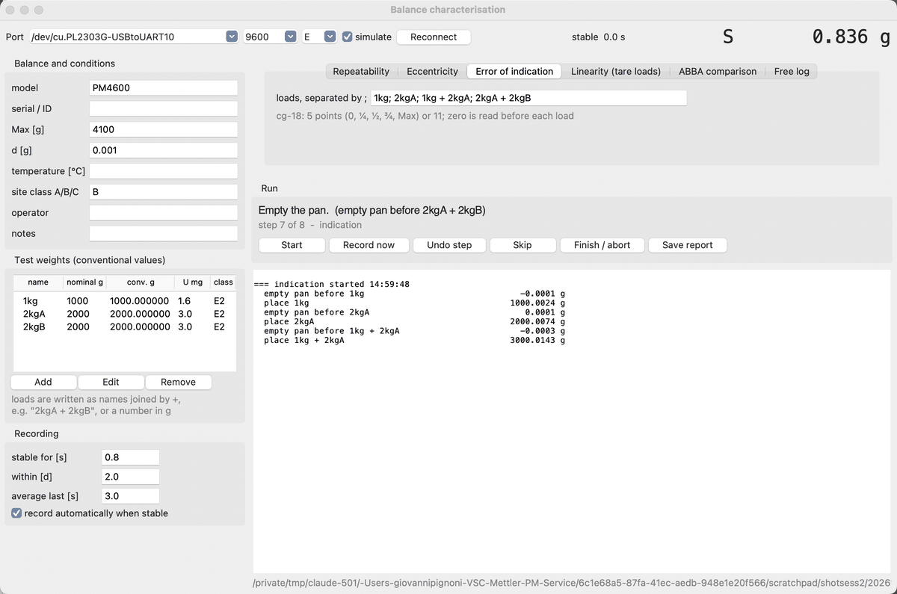

# Precision Scale Characterisation Tool

A small Python tool for characterising a laboratory balance through its serial output: it walks you
through the tests used in balance calibrations and test reports, records every reading, and writes a
report. Written for a modified Mettler-Toledo PM4600, but it works with any balance that streams lines
like `S    294.378 g` (stable) and `SD   294.379 g` (moving).



The test procedures follow the EURAMET calibration guide cg-18 and the Sartorius white papers on balance
test reports, cg-18 calibration and handling test weights. This is a tool for understanding your own
balance, not an accredited calibration: it reports the measured quantities, not a full uncertainty budget.

## Tests

| Test | Procedure | Result |
|---|---|---|
| **Repeatability** | the same load placed 5, 6 or 10 times, pan read empty before each placement | standard deviation `s`; adjustment accuracy = largest deviation from the conventional mass |
| **Eccentricity** | one load at centre, front left, rear left, rear right, front right, unloading in between (cg-18 option 3) | largest deviation from the centre reading |
| **Error of indication** | increasing loads with unloading in between (cg-18: 5 points 0, ¼, ½, ¾, Max, or 11) | error `E = indication - conventional mass` for each point, and the deviation from a straight line through zero and the top load |
| **Linearity, tare-load method** | the same test load placed on tares of about 0, 1, 2, 3 × the test load | linearity curve that does not depend on knowing the test weight's mass ("testing with unknown weights") |
| **ABBA comparison** | reference A and test mass B in A-B-B-A cycles | mean difference B - A with its standard deviation and the standard uncertainty of the mean; with a calibrated A, the mass of B |
| **Free log** | nothing step by step; for warm-up, drift and creep runs | the raw stream, plus time-stamped remarks |

**Zeroing.** The cable is receive-only, so the program never sends commands to the balance. Instead it
reads the empty pan (or the tare) before every load and works with the difference. That also removes slow
drift between steps, so you don't need to press tare between placements.

**Recording.** A step is recorded when the balance has reported stable (`S`) readings, all within ± a few
display steps of each other, for a set time (default 12 s, suited to a balance with long averaging). The
recorded value is the mean of that stable stretch (at most the last 3 s). Recording can be automatic, so
your hands stay free for the weights, or manual with **Record now**. **Undo step** and **Skip** are there
for mistakes.

**Weights.** Enter each weight with its nominal value, its conventional value from the calibration
certificate and its expanded uncertainty `U`. Loads are written as names joined by `+`
(`2kgA + 2kgB`) or as a number in grams. The uncertainties of combined weights are added linearly,
because weights of one set are usually calibrated together and so correlated. Tares in the tare-load test
can be any objects; their mass is never used.

## Output

Each session gets its own folder under `sessions/`:

- `raw.csv` - every line the balance sent, time-stamped
- `steps.csv` - each recorded step: test, instruction, load, value, how long it had been stable
- `report.txt` - balance data, weights and the results of every test in the session
- `session.json` - the same in machine-readable form, including every step

## Setup

Requirements: Python 3 with tkinter (included in the python.org installers) and pyserial
(`python3 -m pip install pyserial`).

```bash
python3 scale_characterise.py              # the GUI
python3 scale_characterise.py --simulate   # try it without a balance
python3 scale_logger.py -o warmup.csv --minutes 180   # plain logger, no GUI
```

### Mettler-Toledo AM/PM balances

**Cable.** The Data I/O socket has RS-232 and current-loop signals; for this tool only two wires are
needed, from the balance's RS-232 output to the PC's input (pinout from the service manual):

| Balance pin | Signal | PC side (DB9) |
|---|---|---|
| 12 | RS out (data from the balance) | pin 2, RxD |
| 13 | RS COM (RS-232 ground) | pin 5, GND |
| 2 | RS in (data to the balance) | not needed |
| 6 | shield | connector shell |

Use a real RS-232 adapter. A bare TTL-level USB-serial board reads the RS-232 signal inverted, giving
regular but unreadable characters, and the RS-232 voltage can damage it.

**Balance configuration** (configuration file, sector I-FACE):

| Setting | Value |
|---|---|
| S (transmission mode) | `cONT`, every reading continuously |
| b (baud rate) | 9600 |
| P (parity) | `-e-`, even |
| Pause | `0` (do not use `H`: hardware handshake would stop the output with this cable) |
| AU (suppress special characters) | `on` |

The PC side is then 9600 baud, 7 data bits, even parity, 1 stop bit, no flow control.

## Limitations

- No measurement-uncertainty budget; the weights' `U` is reported next to the results for comparison.
- The program assumes the balance does not re-zero itself between steps in a way that would change the
  empty-pan reading during a load (auto-zero only acts with an empty pan, so that's normally fine).
- Eccentricity results scale roughly with the load, as the white papers point out; compare them only at
  the same test load.

## Licence

MIT - see [LICENSE](LICENSE). The analysis and code were developed with the help of Claude (Anthropic).
